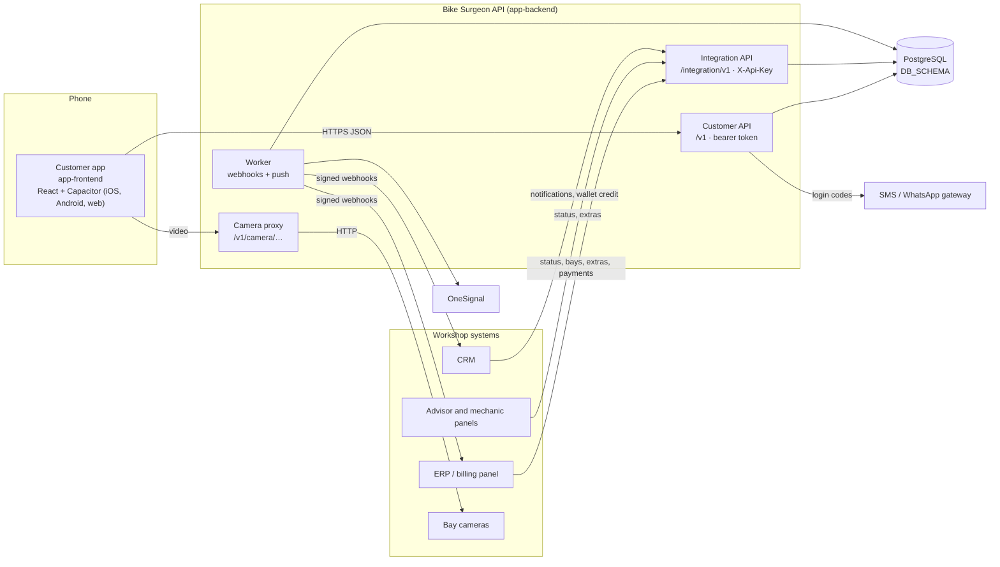
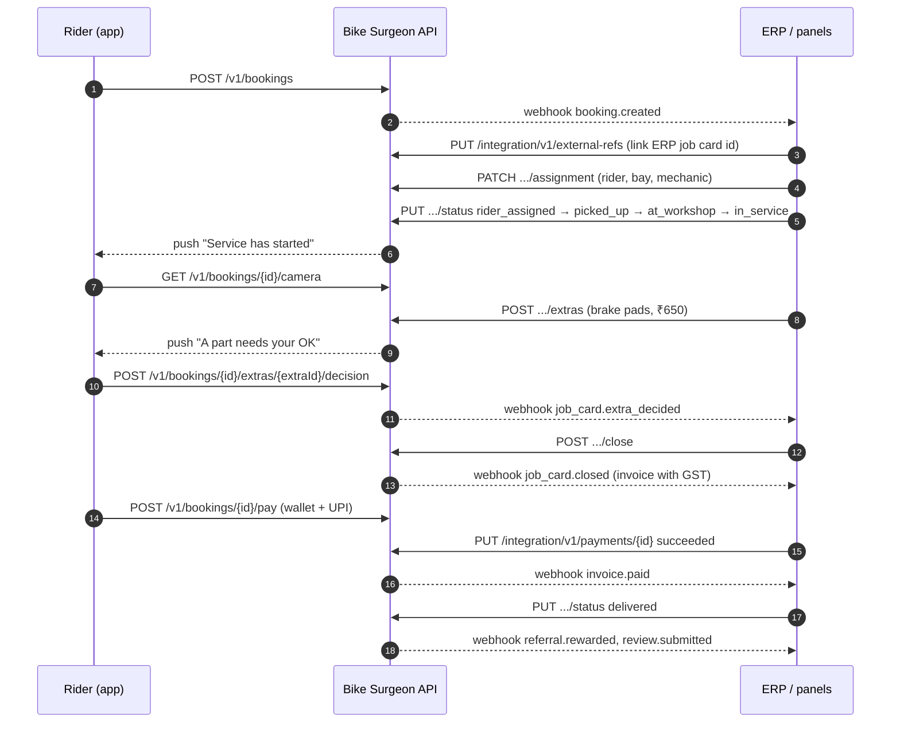

# Architecture

## The pieces



| Component | Where | What it does |
|---|---|---|
| Customer app | `app-frontend/` | The rider's app: login, garage, booking, live tracker and bay camera, part approval, invoice and payment, wallet, referrals, notifications. One React codebase, shipped as iOS and Android apps through Capacitor. |
| Customer API | `app-backend/src/routes/customer.ts` | Everything the app calls. Customers sign in with a phone number and a 4-digit code and get a short-lived access token plus a rotating refresh token. |
| Integration API | `app-backend/src/routes/integration.ts` | The door for the workshop's existing systems. Moves job cards through stages, assigns bays and people, raises extra parts, closes job cards, records cash, and owns the catalogue, staff and bays. |
| Worker | `app-backend/src/worker.ts` | Runs inside the API process. Delivers every event to `WEBHOOK_URL`, signed and in order, with retries, and sends push notifications. |
| Camera proxy | `app-backend/src/routes/system.ts` | Streams the bay camera to the customer through the API, so camera addresses never leave the server. |
| Database | PostgreSQL, `app-backend/db/` | The app's tables in their own schema. See [Database](02-database.md). |

## How a service flows through the system



## Design decisions

**One database, its own schema.** The workshop's billing, advisor and mechanic panels already share one production database. The API keeps its tables in a separate schema (`DB_SCHEMA`) in that same database, or a separate one. This avoids name clashes with existing tables, and backups and access control stay in one place. [Connecting your database](03-connecting-your-database.md) explains the options.

**The integration API is the boundary.** Existing panels and the ERP change job cards through `/integration/v1` rather than writing the app's tables directly. That one path updates the row, appends the timeline, notifies the customer and emits the event, so nothing gets out of step. The previous developer's notes offered "a small set of API endpoints … if a cleaner boundary is preferred"; this is that boundary.

**Transactional outbox.** Every change writes its event to `integration_events` in the same database transaction. If the change committed, the event exists. The worker delivers events in order and retries with backoff, and `GET /integration/v1/events` lets a system replay or poll instead of receiving webhooks.

**Status is one field.** `job_cards.status` is the only thing the tracker reads, as the existing system already works. The seven stages map one to one onto the app's tracker steps.

**Prices are frozen at each step.** Service prices are copied onto the job card when booked, and the invoice copies the job card when it closes. Catalogue changes never rewrite a customer's booking or bill.

**The camera falls out of the job card.** A customer can stream a bay only through their own job card, only while it is in the workshop, and through a link that expires in 15 minutes. No separate camera permissions exist.

**Providers are swappable.** The SMS or WhatsApp gateway, push provider and RC lookup are each picked by environment variables ([`src/providers.ts`](../app-backend/src/providers.ts)). Swapping a vendor never touches the routes.

## Code map

```
app-backend/
  db/migrations/        SQL schema, applied in order by npm run db:migrate
  db/seeds/             reference data and the demo customer
  src/index.ts          starts the HTTP server and the worker
  src/app.ts            routes, error handling, OpenAPI document and /docs
  src/config.ts         every environment variable, validated at startup
  src/db.ts             connection pool (DATABASE_URL, DB_SCHEMA), query helpers
  src/auth.ts           OTP login, sessions, API keys, camera tokens
  src/schemas.ts        request and response schemas (also generate openapi.json)
  src/services/         business rules and SQL, one file per area
  src/routes/           HTTP handlers: customer, integration, system
  src/providers.ts      SMS/WhatsApp, push and RC lookup adapters
  src/worker.ts         webhook delivery and push sending
  scripts/              migrate, seed, check-schema, openapi
  test/api.test.ts      end-to-end test of every flow against PostgreSQL

app-frontend/
  src/customer-app.tsx  every screen (currently on built-in sample data)
  src/App.tsx           navigation stack, theme, test tools
  src/native.ts         Capacitor bridges: status bar, haptics, back button, storage
  ios/, android/        native projects generated by Capacitor
```
