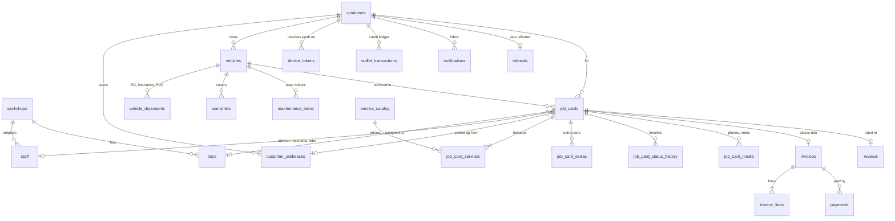

# Database

PostgreSQL 13 or newer. The schema is created by `app-backend/db/migrations/001_initial_schema.sql` and checked by `npm run db:check`. This page is the reference; [Connecting your database](03-connecting-your-database.md) covers how to point the API at a server.

## Conventions

- **Ids** are uuids generated by the database. Catalogue rows (`service_catalog`, `offers`) use readable text ids, and `staff` and `bays` have a unique `code` that integrations use.
- **Human-facing numbers**: job cards are `BS-<year>-<6 digits>` from the `job_card_number_seq` sequence; invoices reuse the digits as `INV-<year>-<6 digits>`.
- **Enumerations** are `text` columns with `CHECK` constraints rather than Postgres enum types, so adding a value is one `ALTER TABLE ... DROP/ADD CONSTRAINT`.
- **Money** is `numeric(12,2)` in Indian rupees. Estimates and catalogue prices are before GST. GST (`GST_RATE`, 18% by default) is calculated when an invoice is issued and rounded to the rupee, which matches what the app displays.
- **Time** is `timestamptz` (stored in UTC). The API returns ISO 8601 strings; calendar dates (`valid_until`, `ends_on`) are plain `date`.
- **updated_at** is maintained by a trigger on every table that has it. Changing a job card's extras, media or payments also bumps the job card's `updated_at`, so `updatedSince` sync catches them.
- **Soft deletes**: `customers.deleted_at`, `customer_addresses.deleted_at` and `vehicles.archived_at`. Nothing customer-facing is hard-deleted, because job cards and invoices must stay intact.

## Job card lifecycle

`job_cards.status` is the live field every screen reads. The tracker's step number is the position in this list.

| stage | status | Set by | What the customer sees |
|---|---|---|---|
| 0 | `booked` | App booking, or ERP walk-in/phone booking | Booking confirmed |
| 1 | `rider_assigned` | ERP / advisor panel | Rider on the way (pickups only) |
| 2 | `picked_up` | ERP / rider | Bike is with the rider (pickups only) |
| 3 | `at_workshop` | ERP / advisor panel | Checked in; camera available if a bay is assigned |
| 4 | `in_service` | ERP / mechanic panel | Being serviced; camera live; extra parts may arrive |
| 5 | `job_closed` | ERP (`POST .../close`) | Invoice ready to pay |
| 6 | `delivered` | ERP / rider | Done; review prompt; referral reward paid |
| -1 | `cancelled` | Customer (before pickup) or ERP | Cancelled, nothing charged |

Rules the API enforces:

- A status can move forward any number of steps (workshop visits skip 1 and 2). Moving backwards, or out of `delivered`/`cancelled`, needs `force: true` from the integration API.
- Moving to `job_closed` or `delivered` issues the invoice if there is none yet. It refuses while extra parts are still `pending`, unless `declinePendingExtras: true` is sent to the close endpoint.
- Customers can cancel only while the job card is `booked` or `rider_assigned`.
- One open job card per vehicle (`job_cards_one_open_per_vehicle`).

## Relationships

The live camera needs no permission table: a customer can only reach the bay their own open job card is assigned to, and only while it is in the workshop.

## Tables

### Workshop, people and bays

#### `workshops`

One row per workshop. The API serves the workshop named by `WORKSHOP_CODE`. Phone numbers feed the app's Call, WhatsApp and Roadside buttons.

| Column | Type | Required | Key |
|---|---|---|---|
| `id` | uuid | yes | PK |
| `code` | text | yes |  |
| `name` | text | yes |  |
| `address` | text | yes |  |
| `city` | text | yes |  |
| `phone` | text |  |  |
| `whatsapp` | text |  |  |
| `roadside_phone` | text |  |  |
| `created_at` | timestamptz | yes |  |
| `updated_at` | timestamptz | yes |  |

#### `staff`

Advisors, mechanics, riders and managers. `code` is the employee code your ERP uses; the integration API addresses staff by code, never by uuid.

| Column | Type | Required | Key |
|---|---|---|---|
| `id` | uuid | yes | PK |
| `workshop_id` | uuid | yes | → workshops |
| `code` | text | yes |  |
| `name` | text | yes |  |
| `role` | text | yes |  |
| `phone` | text |  |  |
| `active` | boolean | yes |  |
| `created_at` | timestamptz | yes |  |
| `updated_at` | timestamptz | yes |  |

#### `bays`

Physical service bays. `camera_stream_url` is the bay camera (HLS playlist, MP4 or MJPEG over HTTP). A customer can watch it only while their job card is assigned to the bay and is `at_workshop` or `in_service`.

| Column | Type | Required | Key |
|---|---|---|---|
| `id` | uuid | yes | PK |
| `workshop_id` | uuid | yes | → workshops |
| `code` | text | yes |  |
| `name` | text | yes |  |
| `camera_stream_url` | text |  |  |
| `active` | boolean | yes |  |
| `created_at` | timestamptz | yes |  |
| `updated_at` | timestamptz | yes |  |

### Catalogue

#### `service_catalog`

Bookable services. `id` is a stable code (`general`, `oil`, ...). `price` is before GST. Prices are copied onto each job card when it is booked, so later price changes never alter an existing booking.

| Column | Type | Required | Key |
|---|---|---|---|
| `id` | text | yes | PK |
| `name` | text | yes |  |
| `detail` | text | yes |  |
| `category` | text | yes |  |
| `price` | numeric(12,2) | yes |  |
| `sac_code` | text |  |  |
| `active` | boolean | yes |  |
| `sort_order` | integer | yes |  |
| `created_at` | timestamptz | yes |  |
| `updated_at` | timestamptz | yes |  |

#### `offers`

Discounts shown in the app. `first_booking_only`, `requires_service_id` and `requires_other_service` are enforced when a booking is created.

| Column | Type | Required | Key |
|---|---|---|---|
| `id` | text | yes | PK |
| `title` | text | yes |  |
| `short_label` | text | yes |  |
| `detail` | text | yes |  |
| `discount_amount` | numeric(12,2) | yes |  |
| `first_booking_only` | boolean | yes |  |
| `requires_service_id` | text |  | → service_catalog |
| `requires_other_service` | boolean | yes |  |
| `valid_until` | date |  |  |
| `active` | boolean | yes |  |
| `created_at` | timestamptz | yes |  |
| `updated_at` | timestamptz | yes |  |

### Customers and sign-in

#### `customers`

Phone-based accounts. `phone` is E.164 (`+91XXXXXXXXXX`). Deleting an account scrubs personal fields and sets `deleted_at`; job cards and invoices stay for accounting.

| Column | Type | Required | Key |
|---|---|---|---|
| `id` | uuid | yes | PK |
| `phone` | text | yes |  |
| `name` | text | yes |  |
| `email` | text |  |  |
| `language` | text | yes |  |
| `backup_contact_name` | text |  |  |
| `backup_contact_phone` | text |  |  |
| `referral_code` | text | yes |  |
| `referred_by_customer_id` | uuid |  | → customers |
| `created_at` | timestamptz | yes |  |
| `updated_at` | timestamptz | yes |  |
| `deleted_at` | timestamptz |  |  |

#### `customer_addresses`

Pickup and delivery addresses. Soft-deleted with `deleted_at`. Saving an address with an existing label replaces the old one.

| Column | Type | Required | Key |
|---|---|---|---|
| `id` | uuid | yes | PK |
| `customer_id` | uuid | yes | → customers |
| `label` | text | yes |  |
| `area` | text | yes |  |
| `line` | text | yes |  |
| `landmark` | text |  |  |
| `contact_name` | text |  |  |
| `contact_phone` | text |  |  |
| `latitude` | numeric(9,6) |  |  |
| `longitude` | numeric(9,6) |  |  |
| `created_at` | timestamptz | yes |  |
| `updated_at` | timestamptz | yes |  |
| `deleted_at` | timestamptz |  |  |

#### `otp_challenges`

Login codes, stored only as an HMAC. Five codes per phone per 15 minutes, five wrong attempts per code.

| Column | Type | Required | Key |
|---|---|---|---|
| `id` | uuid | yes | PK |
| `phone` | text | yes |  |
| `code_hash` | text | yes |  |
| `channel` | text | yes |  |
| `attempts` | integer | yes |  |
| `expires_at` | timestamptz | yes |  |
| `consumed_at` | timestamptz |  |  |
| `created_at` | timestamptz | yes |  |

#### `auth_sessions`

Refresh tokens, stored as SHA-256 hashes. Rotated on every refresh; revoked on logout and account deletion.

| Column | Type | Required | Key |
|---|---|---|---|
| `id` | uuid | yes | PK |
| `customer_id` | uuid | yes | → customers |
| `refresh_token_hash` | text | yes |  |
| `user_agent` | text |  |  |
| `expires_at` | timestamptz | yes |  |
| `revoked_at` | timestamptz |  |  |
| `last_used_at` | timestamptz |  |  |
| `created_at` | timestamptz | yes |  |

#### `device_tokens`

Push targets per phone (OneSignal subscription id today; FCM/APNs tokens are allowed). Matches the device-token table the existing system uses.

| Column | Type | Required | Key |
|---|---|---|---|
| `id` | uuid | yes | PK |
| `customer_id` | uuid | yes | → customers |
| `provider` | text | yes |  |
| `platform` | text | yes |  |
| `token` | text | yes |  |
| `created_at` | timestamptz | yes |  |
| `last_seen_at` | timestamptz | yes |  |

### Vehicles (the garage)

#### `vehicles`

A customer's bikes. `registration_number` is stored normalised (`KA01MY4500`) and is unique among active vehicles. `body_type` drives the bike illustration in the app. Archiving keeps history.

| Column | Type | Required | Key |
|---|---|---|---|
| `id` | uuid | yes | PK |
| `customer_id` | uuid | yes | → customers |
| `registration_number` | text | yes |  |
| `make` | text | yes |  |
| `model` | text | yes |  |
| `body_type` | text | yes |  |
| `colour_name` | text |  |  |
| `colour_hex` | text |  |  |
| `make_year` | smallint |  |  |
| `chassis_last4` | text |  |  |
| `odometer_km` | integer |  |  |
| `odometer_recorded_at` | timestamptz |  |  |
| `odometer_source` | text |  |  |
| `created_at` | timestamptz | yes |  |
| `updated_at` | timestamptz | yes |  |
| `archived_at` | timestamptz |  |  |

#### `vehicle_documents`

RC, insurance and PUC details, one row per kind per vehicle. `file_url` points at wherever the photo is stored.

| Column | Type | Required | Key |
|---|---|---|---|
| `id` | uuid | yes | PK |
| `vehicle_id` | uuid | yes | → vehicles |
| `kind` | text | yes |  |
| `file_url` | text |  |  |
| `provider` | text |  |  |
| `policy_type` | text |  |  |
| `reading` | text |  |  |
| `valid_until` | date |  |  |
| `created_at` | timestamptz | yes |  |
| `updated_at` | timestamptz | yes |  |

#### `maintenance_items`

Kilometre-based wear items (engine oil, chain, pads) for the garage's wear meters.

| Column | Type | Required | Key |
|---|---|---|---|
| `id` | uuid | yes | PK |
| `vehicle_id` | uuid | yes | → vehicles |
| `item` | text | yes |  |
| `last_done_km` | integer | yes |  |
| `interval_km` | integer |  |  |
| `interval_months` | integer |  |  |
| `updated_at` | timestamptz | yes |  |

#### `warranties`

Bike and part warranties. `job_card_id` links a part warranty to the job that fitted it.

| Column | Type | Required | Key |
|---|---|---|---|
| `id` | uuid | yes | PK |
| `vehicle_id` | uuid | yes | → vehicles |
| `job_card_id` | uuid |  | → job_cards |
| `title` | text | yes |  |
| `brand` | text | yes |  |
| `serial_number` | text |  |  |
| `starts_on` | date |  |  |
| `ends_on` | date |  |  |
| `ends_at_km` | integer |  |  |
| `created_at` | timestamptz | yes |  |
| `updated_at` | timestamptz | yes |  |

### Job cards: the central service record

#### `job_cards`

One row per service visit, created by an app booking or by the ERP (walk-in, phone). `status` is the single field that drives every customer-visible stage. `package_subtotal`, `discount_amount` and `estimate_amount` are before GST. One open job card per vehicle is enforced by a unique index.

| Column | Type | Required | Key |
|---|---|---|---|
| `id` | uuid | yes | PK |
| `number` | text | yes |  |
| `workshop_id` | uuid | yes | → workshops |
| `customer_id` | uuid | yes | → customers |
| `vehicle_id` | uuid | yes | → vehicles |
| `status` | text | yes |  |
| `mode` | text | yes |  |
| `source` | text | yes |  |
| `pickup_address_id` | uuid |  | → customer_addresses |
| `slot_start` | timestamptz | yes |  |
| `slot_end` | timestamptz | yes |  |
| `promised_ready_at` | timestamptz |  |  |
| `bay_id` | uuid |  | → bays |
| `advisor_id` | uuid |  | → staff |
| `mechanic_id` | uuid |  | → staff |
| `rider_id` | uuid |  | → staff |
| `offer_id` | text |  | → offers |
| `package_subtotal` | numeric(12,2) | yes |  |
| `discount_amount` | numeric(12,2) | yes |  |
| `estimate_amount` | numeric(12,2) | yes |  |
| `pay_at_delivery` | boolean | yes |  |
| `odometer_km_at_intake` | integer |  |  |
| `customer_note` | text |  |  |
| `cancel_reason` | text |  |  |
| `created_at` | timestamptz | yes |  |
| `updated_at` | timestamptz | yes |  |
| `closed_at` | timestamptz |  |  |
| `delivered_at` | timestamptz |  |  |
| `cancelled_at` | timestamptz |  |  |

#### `job_card_services`

The services on a job card, with name and price copied at booking time.

| Column | Type | Required | Key |
|---|---|---|---|
| `job_card_id` | uuid | yes | PK → job_cards |
| `service_id` | text | yes | PK → service_catalog |
| `name` | text | yes |  |
| `price` | numeric(12,2) | yes |  |

#### `job_card_status_history`

Every status change with who made it and where it came from. Feeds the tracker's timeline.

| Column | Type | Required | Key |
|---|---|---|---|
| `id` | bigint | yes | PK |
| `job_card_id` | uuid | yes | → job_cards |
| `from_status` | text |  |  |
| `to_status` | text | yes |  |
| `source` | text | yes |  |
| `changed_by_staff_id` | uuid |  | → staff |
| `note` | text |  |  |
| `created_at` | timestamptz | yes |  |

#### `job_card_extras`

Extra parts the bay recommends. Nothing is fitted until `status` is `approved`. `decided_via` records whether the customer decided in the app or told the advisor by phone.

| Column | Type | Required | Key |
|---|---|---|---|
| `id` | uuid | yes | PK |
| `job_card_id` | uuid | yes | → job_cards |
| `part_name` | text | yes |  |
| `note` | text | yes |  |
| `amount` | numeric(12,2) | yes |  |
| `status` | text | yes |  |
| `raised_by_staff_id` | uuid |  | → staff |
| `raised_by_label` | text |  |  |
| `decided_at` | timestamptz |  |  |
| `decided_via` | text |  |  |
| `created_at` | timestamptz | yes |  |
| `updated_at` | timestamptz | yes |  |

#### `job_card_media`

Photos, videos and notes from the bay.

| Column | Type | Required | Key |
|---|---|---|---|
| `id` | uuid | yes | PK |
| `job_card_id` | uuid | yes | → job_cards |
| `kind` | text | yes |  |
| `url` | text |  |  |
| `caption` | text | yes |  |
| `created_by_staff_id` | uuid |  | → staff |
| `created_at` | timestamptz | yes |  |

### Billing, payments and wallet

#### `invoices`

Issued when a job card closes. Frozen copy of the package, discount, approved extras and GST. `number` mirrors the job card number (`BS-2026-000124` becomes `INV-2026-000124`).

| Column | Type | Required | Key |
|---|---|---|---|
| `id` | uuid | yes | PK |
| `number` | text | yes |  |
| `job_card_id` | uuid | yes | → job_cards |
| `customer_id` | uuid | yes | → customers |
| `status` | text | yes |  |
| `subtotal` | numeric(12,2) | yes |  |
| `discount_amount` | numeric(12,2) | yes |  |
| `extras_amount` | numeric(12,2) | yes |  |
| `taxable_amount` | numeric(12,2) | yes |  |
| `gst_rate` | numeric(5,4) | yes |  |
| `gst_amount` | numeric(12,2) | yes |  |
| `total` | numeric(12,2) | yes |  |
| `issued_at` | timestamptz | yes |  |
| `paid_at` | timestamptz |  |  |
| `created_at` | timestamptz | yes |  |
| `updated_at` | timestamptz | yes |  |

#### `invoice_lines`

Line items. Discounts are negative lines. `sac_hsn_code` is copied from the service catalogue for GST filing.

| Column | Type | Required | Key |
|---|---|---|---|
| `id` | uuid | yes | PK |
| `invoice_id` | uuid | yes | → invoices |
| `kind` | text | yes |  |
| `label` | text | yes |  |
| `sac_hsn_code` | text |  |  |
| `quantity` | numeric(10,2) | yes |  |
| `unit_amount` | numeric(12,2) | yes |  |
| `amount` | numeric(12,2) | yes |  |
| `sort_order` | integer | yes |  |

#### `payments`

Money against an invoice. Wallet payments succeed immediately; online payments start `pending` until the gateway or ERP confirms them; cash and UPI collected by the workshop are recorded as `succeeded`.

| Column | Type | Required | Key |
|---|---|---|---|
| `id` | uuid | yes | PK |
| `invoice_id` | uuid | yes | → invoices |
| `customer_id` | uuid | yes | → customers |
| `method` | text | yes |  |
| `amount` | numeric(12,2) | yes |  |
| `status` | text | yes |  |
| `provider` | text | yes |  |
| `provider_reference` | text |  |  |
| `collected_by_staff_id` | uuid |  | → staff |
| `created_at` | timestamptz | yes |  |
| `confirmed_at` | timestamptz |  |  |
| `updated_at` | timestamptz | yes |  |

#### `wallet_transactions`

Workshop credit ledger. Positive amounts are credits, negative are spends. The balance is the sum (see the `customer_wallet_balances` view).

| Column | Type | Required | Key |
|---|---|---|---|
| `id` | uuid | yes | PK |
| `customer_id` | uuid | yes | → customers |
| `amount` | numeric(12,2) | yes |  |
| `kind` | text | yes |  |
| `title` | text | yes |  |
| `detail` | text | yes |  |
| `job_card_id` | uuid |  | → job_cards |
| `payment_id` | uuid |  | → payments |
| `created_at` | timestamptz | yes |  |

#### `customer_wallet_balances`

View: current wallet balance per customer.

| Column | Type | Required | Key |
|---|---|---|---|
| `customer_id` | uuid |  |  |
| `balance` | numeric(12,2) |  |  |

#### `referrals`

Who referred whom. When the referred customer's first job card is delivered, both get `reward_amount` as wallet credit.

| Column | Type | Required | Key |
|---|---|---|---|
| `id` | uuid | yes | PK |
| `referrer_customer_id` | uuid | yes | → customers |
| `referee_customer_id` | uuid | yes | → customers |
| `status` | text | yes |  |
| `reward_amount` | numeric(12,2) | yes |  |
| `rewarded_job_card_id` | uuid |  | → job_cards |
| `rewarded_at` | timestamptz |  |  |
| `created_at` | timestamptz | yes |  |

### Notifications and reviews

#### `notifications`

The app's notification inbox. `target_screen` is the app screen to open. The worker pushes rows where `pushed_at` is null.

| Column | Type | Required | Key |
|---|---|---|---|
| `id` | uuid | yes | PK |
| `customer_id` | uuid | yes | → customers |
| `job_card_id` | uuid |  | → job_cards |
| `kind` | text | yes |  |
| `title` | text | yes |  |
| `body` | text | yes |  |
| `target_screen` | text |  |  |
| `read_at` | timestamptz |  |  |
| `pushed_at` | timestamptz |  |  |
| `created_at` | timestamptz | yes |  |

#### `reviews`

Post-service ratings. `follow_up_interests` ("Next service", "A tyre check") are sales leads for the CRM.

| Column | Type | Required | Key |
|---|---|---|---|
| `id` | uuid | yes | PK |
| `job_card_id` | uuid | yes | → job_cards |
| `customer_id` | uuid | yes | → customers |
| `stars` | smallint | yes |  |
| `tags` | text[] | yes |  |
| `note` | text |  |  |
| `work_votes` | jsonb | yes |  |
| `staff_vote` | text |  |  |
| `follow_up_interests` | text[] | yes |  |
| `created_at` | timestamptz | yes |  |

### Integration

#### `external_references`

Maps our records to ids in your CRM/ERP, per system. `entity_id` is our uuid, or the code for services, offers, staff and bays.

| Column | Type | Required | Key |
|---|---|---|---|
| `entity_type` | text | yes | PK |
| `entity_id` | text | yes | PK |
| `system` | text | yes | PK |
| `external_id` | text | yes |  |
| `created_at` | timestamptz | yes |  |
| `updated_at` | timestamptz | yes |  |

#### `integration_events`

Transactional outbox. Every change writes an event in the same transaction; the worker delivers them as webhooks in order, and `GET /integration/v1/events` lets you read them.

| Column | Type | Required | Key |
|---|---|---|---|
| `id` | bigint | yes | PK |
| `event_type` | text | yes |  |
| `entity_type` | text | yes |  |
| `entity_id` | text | yes |  |
| `payload` | jsonb | yes |  |
| `created_at` | timestamptz | yes |  |
| `delivered_at` | timestamptz |  |  |
| `attempts` | integer | yes |  |
| `next_attempt_at` | timestamptz | yes |  |
| `last_error` | text |  |  |

## Allowed values

| Column | Values |
|---|---|
| `job_cards.status` | `booked`, `rider_assigned`, `picked_up`, `at_workshop`, `in_service`, `job_closed`, `delivered`, `cancelled` |
| `job_cards.mode` | `pickup`, `visit` |
| `job_cards.source` | `app`, `walk_in`, `phone`, `erp` |
| `job_card_extras.status` | `pending`, `approved`, `declined` |
| `job_card_extras.decided_via` | `app`, `advisor`, `integration` |
| `invoices.status` | `open`, `paid`, `void` |
| `invoice_lines.kind` | `service`, `part`, `discount`, `other` |
| `payments.method` | `upi`, `card`, `netbanking`, `cash`, `wallet` |
| `payments.status` | `pending`, `succeeded`, `failed`, `refunded` |
| `wallet_transactions.kind` | `welcome`, `referral`, `refund`, `cashback`, `service_payment`, `adjustment` |
| `notifications.kind` | `confirmation`, `update`, `reminder`, `rescheduled`, `cancelled`, `payment`, `offer` |
| `staff.role` | `advisor`, `mechanic`, `rider`, `manager` |
| `service_catalog.category` | `Service`, `Repair`, `Care` |
| `vehicles.body_type` | `commuter`, `naked`, `classic`, `cruiser`, `touring`, `sports`, `superbike`, `adventure`, `chopper`, `cafe`, `scrambler`, `scooter`, `moped`, `dirt`, `bobber`, `powercruiser` |
| `vehicle_documents.kind` | `rc`, `insurance`, `puc` |
| `customers.language` | `English`, `Kannada`, `Hindi` |
| `device_tokens.provider` / `platform` | `onesignal`, `fcm`, `apns` / `ios`, `android`, `web` |

## Changing the schema

Add a new numbered file to `app-backend/db/migrations/` (for example `002_add_job_card_priority.sql`) and run `npm run db:migrate`. Applied files are recorded in `schema_migrations` and never re-run, so do not edit a migration that has already been applied anywhere. The runner takes an advisory lock, so two instances starting at once cannot both migrate.

## Seed data

- `db/seeds/01_reference.sql`: the workshop, three staff, four bays, six services and three offers. Safe to re-run. Replace the placeholder address and phone numbers before go-live, or let the ERP own these rows through `PUT /integration/v1/staff|bays|services|offers`.
- `db/seeds/02_demo_customer.sql`: the frontend's "Returning" sample customer (`+91 98765 43210`) with three bikes, a live job in Bay 03 with two parts waiting for approval, a paid invoice, wallet credit and notifications. Development and staging only; the seed script refuses to load it when `NODE_ENV=production`.
